<p align="center">
  <a href="https://lilykos.github.io/orca-the-lobby/">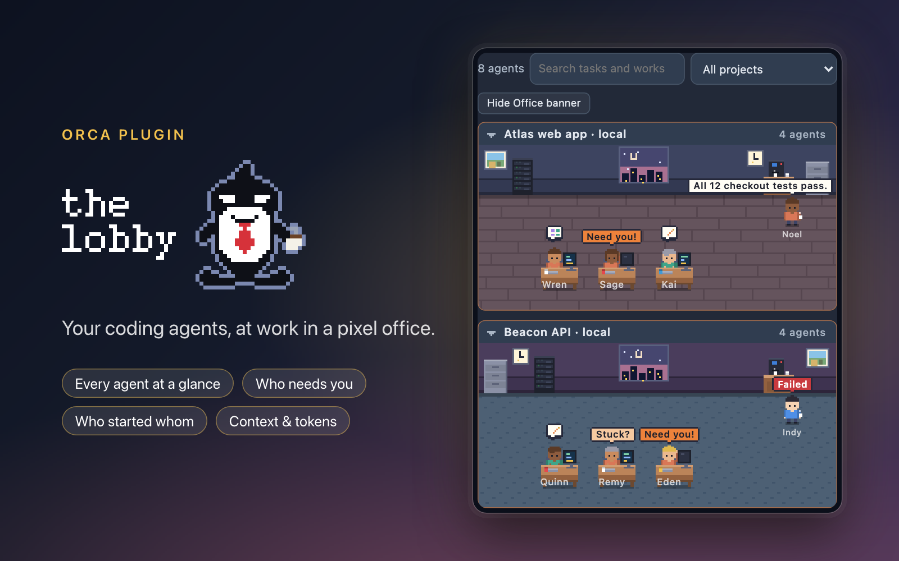</a>
</p>

# The Lobby

**Every agent in every worktree, in one live view. See who is working, who is stuck and who needs you, without opening a single tab.**

An [Orca](https://onorca.dev) plugin that turns your parallel coding agents into little pixel people: one room per project, one desk per agent.

### [Take the tour: lilykos.github.io/orca-the-lobby](https://lilykos.github.io/orca-the-lobby/)

## Why you'd want it

- **See everything at once.** Every agent in every worktree, one room per project. Worktrees of a repo share a room, and counts show how many are working, need you, are done or failed.
- **Know who needs you.** Speech bubbles say **Need you!**, **Stuck?** or **Failed**, **Needs attention** dims the rest, and an optional desktop notification fires when an agent has gone quiet for 10 to 60 minutes.
- **See who started whom.** An org chart per project, drawn from the exact parent-to-worker links Orca reports, across worktrees. Nothing is guessed.
- **Act without hunting through tabs.** Open any agent to jump to its terminal, send it an instruction (terminal agents), or compact a Claude Code conversation. `Cmd/Ctrl+Alt+↑/↓` steps through the agents that need you first.
- **Watch the context fill.** Context and tokens per agent, and tokens today per project, read from your Claude Code and Codex logs. Per-agent context needs a macOS chat session; see the [limits](#honest-limits).
- **Private and tidy.** Nothing leaves your machine and there is no telemetry. A day and night window, five extra palettes plus Orca's own theme, and reduced motion respected.

<p align="center">
  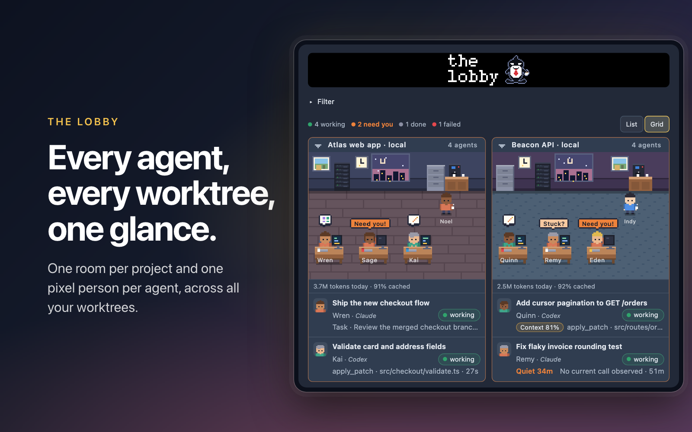
</p>

## Install

Requires Orca **1.4.248 or newer**.

```sh
orca plugin install Lilykos/orca-the-lobby
```

Orca shows the permissions the plugin asks for ([below](#permissions)) and asks you to approve them. Then open **The Lobby** from the right sidebar. The plugin is also listed in the [Orca community catalog](https://github.com/stablyai/orca-community-plugins) (Settings → Plugins) once published there.

## Screenshots

| Know who needs you | See who started whom |
| --- | --- |
| 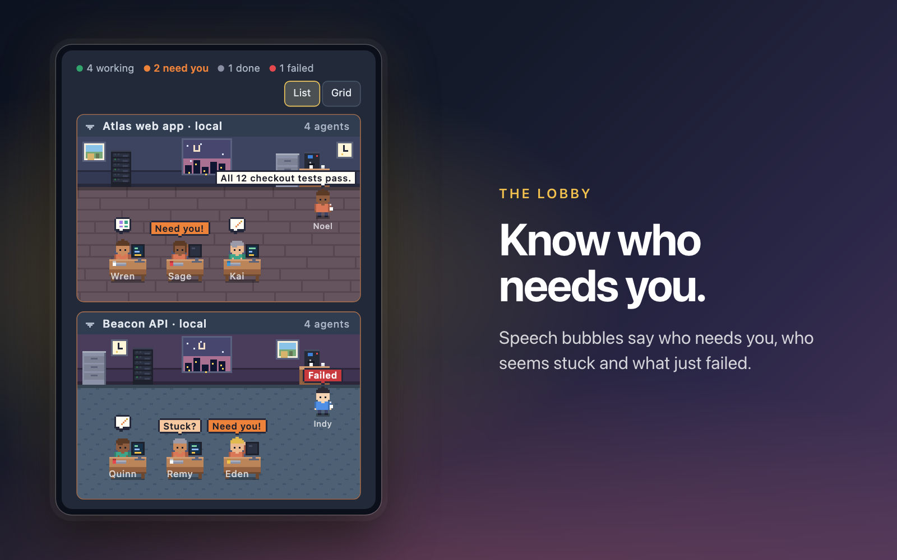 | 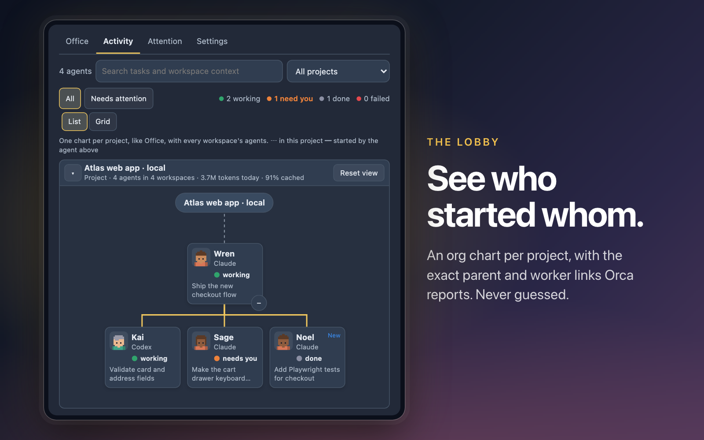 |
| **Act without hunting through tabs** | **Watch the context fill** |
| 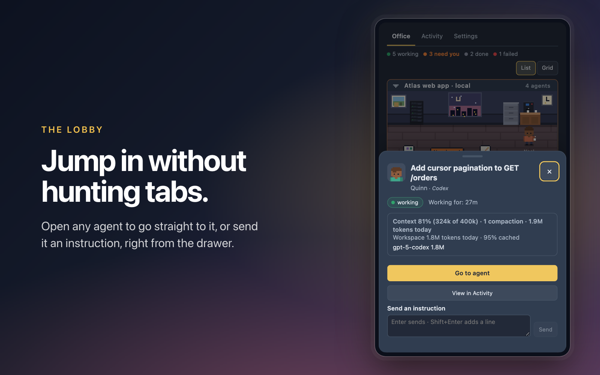 | 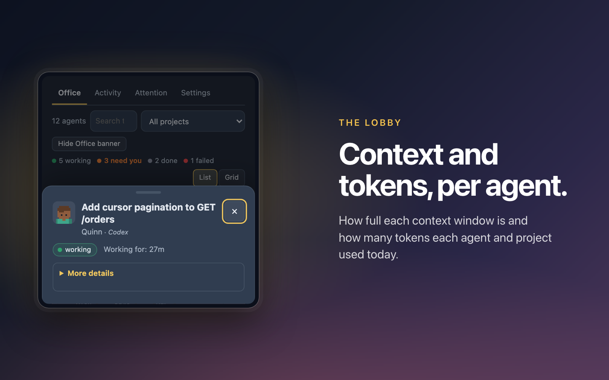 |

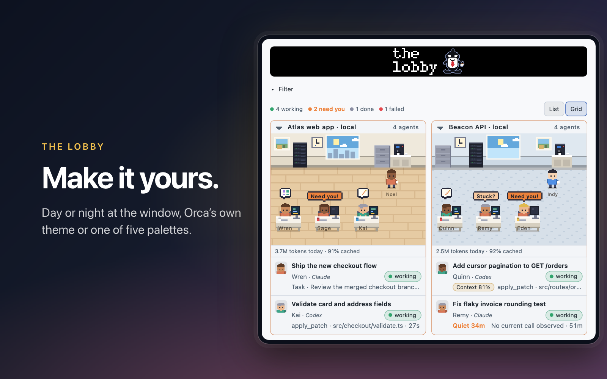

The panel itself, with demo data:

| Office, list | Office, light theme | Settings |
| --- | --- | --- |
| 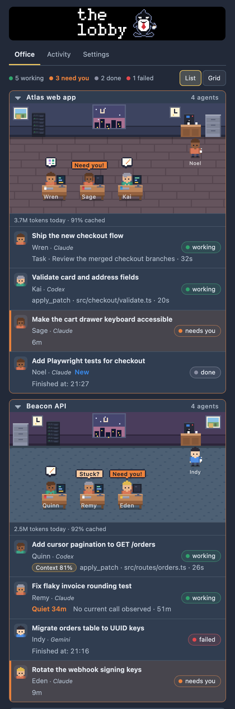 | 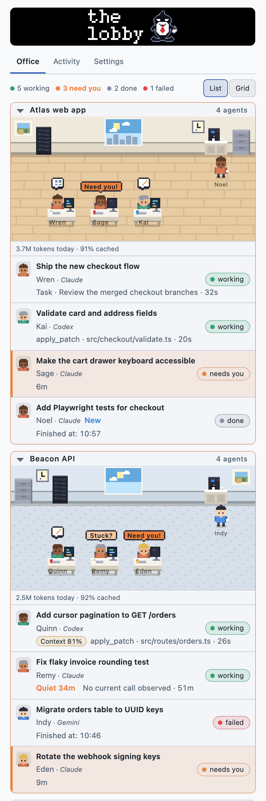 | 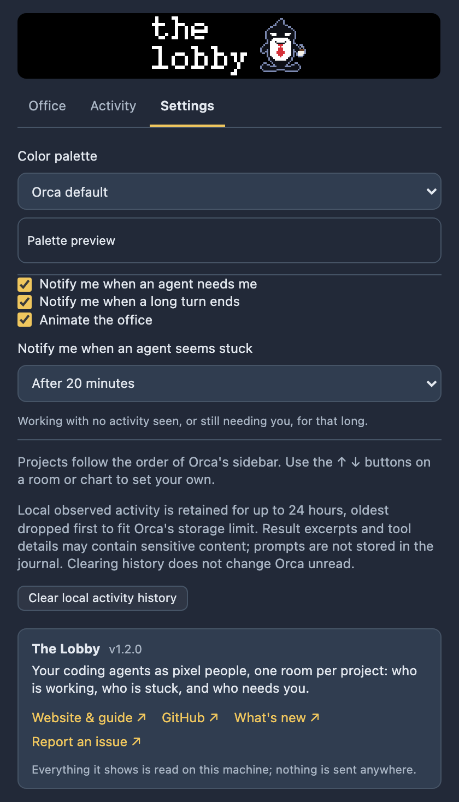 |

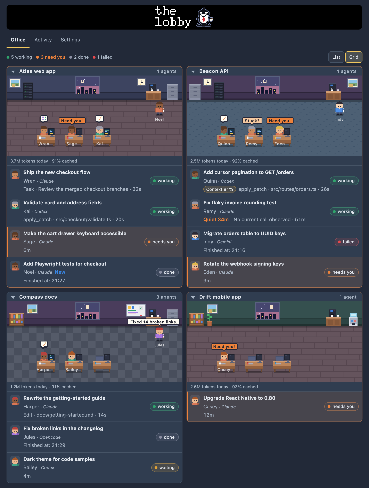

## Features

### Office

- **One room per project checkout.** Worktrees of the same repository share its room. Click a room's sign to fold or unfold it.
- **Projects in your order.** Rooms and charts follow the order of Orca's sidebar, and move when you reorder it there. Point at a room (or use a chart's header) and press **↑** / **↓** to set your own order instead; it is kept, shared by Office and Activity, and **Use the sidebar order again** in Settings undoes it.
- **Working agents sit at desks** (at least three per room, more rows as needed). A small icon above them shows what Orca reports them doing: thinking, shell, web, edit, read, search, plan, a tool, or delegating to a sub-agent. Each person has a friendly name, shown under them.
- **Finished agents stand at the coffee machine** (up to four are drawn). A window follows your local time of day, and a few decorations (plant, noticeboard, server rack, bookshelf, clock and so on) fill clear space.
- **Speech bubbles**, one per person, in priority order: **Need you!** while an agent is blocked, **Stuck?** once a working agent has been quiet longer than your stuck setting, then for 20 seconds after an agent finishes the first line of its last reply (or **Failed**). Click a bubble to open that agent.
- **A roster under each room**: conversation title (or a labeled prompt excerpt), provider (Claude, Codex, …), state, current work, uncommitted changes and a **Context** badge from 70% (amber) and 90% (red) where the context fill is known. Hover a person for a card with the same details.
- **Status colors**: green working, orange **Needs you**, amber waiting, red failed, grey done, blue done with an unread result.
- **Tokens today** per project appear under each room.
- **List or Grid.** Grid puts two projects on each row once the panel is at least 400px wide.

### Activity

- **A connected chart per project**: a project hub at the top, agents below it. Dashed lines show which agents belong to the project; solid lines show only parent/child links Orca reports (a supervised worker's parent, and agent children listed under an agent). Nothing is guessed: an agent whose reported parent is not in the roster stays unlinked with a short note.
- **Agent boxes** show a portrait, name, provider, state and task. Click one to open its drawer. Use the branch buttons to expand reported children; a child without a matching agent opens a small drawer with the state, operation and description Orca reported.
- **All / Needs attention.** Needs attention highlights blocked and failed agents and dims the rest, without removing anything; a project with nothing to act on folds to one line, and an empty state offers **Show all agents**.
- **Navigation:** the page scrolls up and down; wide charts pan with a trackpad swipe, Shift+wheel, the left and right arrow keys, or dragging the background. **Reset view** recentres. Each chart folds with its ▾ button, moves with **↑** / **↓**, and counts and tokens are shown in its header. List / Grid works here too.

### Agent drawer

Click an agent in the Office (roster or scene) or the Activity chart. The drawer slides up over the panel; Escape, the × button or a click outside closes it and returns focus.

- **Status**: state, how long, observed work, and whether it is overdue.
- **Context and tokens** (see [what is read](#data-and-privacy)): for example `Context 73% (512k of 700k) · 2 compactions · 1.2M tokens today`, plus the workspace's tokens for the day by model, split into input, output, cache read and cache write.
- **Details**: asked and result excerpts, current work, uncommitted changes, **Calls** (running and recent tool calls, with sub-agents), **Tasks** and **Files** (heuristic, from Claude Code transcripts) and **PRs** Orca has linked to the workspace.
- **Go to agent** brings its terminal to the front. For an Orca chat session, Orca gives plugins no way to pick a chat tab, so it opens the agent's workspace and says so.
- **Instruction box** (terminal agents only): sends your text to the agent's terminal. Enter sends, Shift+Enter adds a line.
- **Compact conversation** (Claude Code agents in a terminal): types `/compact` after you confirm.
- **View in Activity** (from the Office) finds the agent in its project's chart.

Controls that cannot work for an agent are left out. A blocked agent says it needs you and points to **Go to agent**: Orca does not tell plugins what an agent is asking or offer approve/deny controls. Live updates never rebuild the controls, so what you are typing is not disturbed.

### Settings

- **Color palette**: Orca default (follows the app theme), Catppuccin Mocha / Latte, Dracula, GitHub Dark / Light. It colors the panel and room artwork; state colors keep their meaning.
- **Notify me when an agent needs me** and **Notify me when a long turn ends** (turns over a minute).
- **Notify me when an agent seems stuck**: Off, or after 10, 20 (default), 30 or 60 minutes. One notification per quiet spell, when a working agent has shown no status, tool call or roster update for that long, or a blocked agent still needs you.
- **Animate the office**: off, the scene holds still (also when the system asks for reduced motion; bubbles still show).
- **Clear local activity history**: empties the plugin's stored observation journal.

### Status bar and shortcuts

- The status bar item reads `N working`, or `N working · M need you`.
- **Previous agent** / **Next agent** (command palette, or `Mod+Alt+↑` / `Mod+Alt+↓`) step through agents that need you first, then working ones, then the rest, in a steady order, and jump to each like **Go to agent**. They step on from the agent open in the drawer or the last one they went to.

## Permissions

Orca asks you to approve these when you install. The plugin asks for no more than it uses.

| Capability | Used for | When |
| --- | --- | --- |
| `agent:read` | Agent status and tool-call events, and Orca's agent list for the focused workspace | Continuously, to draw the Lobby |
| `workspace:read` | Workspace names and paths, to group agents into project rooms | Continuously |
| `storage:own` | The plugin's own storage: your settings and the saved office state | On setting changes, and every few seconds while the state changes |
| `workspace:write` | Opens a workspace or brings a terminal to the front | Only when you press **Go to agent**, or use Previous / Next agent |
| `terminal:send` | Types into an agent's terminal | Only when you press **Send** or confirm **Compact conversation**. Never on its own |
| `notifications:show` | Desktop notifications | Only for the events you left on in Settings; none if you turn them off |

The plugin also reads agent events through hooks (`agent.tool.before` / `agent.tool.after`). They only record the call and never deny or change one. It runs as a trusted worker, so it has your user's file access; the [next section](#data-and-privacy) says what it touches.

## Data and privacy

**Nothing leaves your machine.** The plugin makes no network requests, has no analytics and sends nothing to a server.

**What it reads, and from where**

- **Orca**: `orca worktree ps --json` (agents across worktrees, with their state, task title, a prompt and last-reply excerpt, current operation, sub-agents and linked PRs), the host's agent and workspace APIs, `orca repo list --json` every 10 s for the sidebar's project order, and `orca terminal list|switch|send` for the drawer actions. It polls every 3 s while an agent is working and every 20 s when idle.
- **Git**: `git diff --shortstat HEAD` in each workspace with an agent, for the uncommitted-changes count. New untracked files are not counted.
- **Claude Code logs** (`~/.claude/projects/`) and **Codex logs** (`~/.codex/sessions/`): usage numbers and model ids for tokens today; for Claude, also task lists and changed file names for **Tasks** and **Files**. Each file is read once and then only what is appended.
- **Orca's session store** (`~/Library/Application Support/orca/agent-session-journal.db`, read-only through the `sqlite3` macOS ships): only the provider and session id of a chat agent, to find its own log for the context line. Never prompts or messages.

**What it stores** (in Orca's per-plugin storage, nowhere else):

- Your settings.
- The office state: current agents with their title, short prompt and last-reply excerpts (up to 400 characters), tool-call labels (up to 80 characters), recent state history, and the counts for today.
- A bounded observation journal of state changes and tool calls: at most 24 hours, oldest dropped first to fit Orca's 256 KiB limit. It may hold clipped tool details and result excerpts; it does not store prompts. **Clear local activity history** in Settings empties it. The journal is never sent to the panel.

**What it types.** The plugin types into a terminal only after you press **Send** or confirm **Compact conversation**, and only while Orca's own list still shows that agent working in a terminal no other agent shares.

## Honest limits

- **Orca reports less than you might hope.** There is no selected-model field, so the provider label (Claude, Codex, …) is not a model name. Orca does not say what a blocked agent is asking, and gives plugins no approve/deny and no way to pick a chat tab.
- **Context comes from an exact id chain, only for Orca chat sessions on macOS.** Orca's session store (an Orca internal, not a documented API) names the provider session id, and that id is in the log's file name. Agents in a terminal tab and other providers have no verified link, so they show nothing. Claude Code logs state no context window, so Claude agents show tokens without a percentage rather than a guessed one. Tokens today count only the agent's current provider session. A future Orca release could change the store; the lines then disappear.
- **Tokens are counted for Claude Code and Codex only**, per workspace and per project for the local day, with cache read and write separate. No cost estimate is made.
- **Tasks and Files are heuristic.** They come from Claude transcripts matched to an agent by title and prompt similarity, which can be ambiguous when several agents look alike.
- **Observation is sampled.** Short chat tool calls can fall between roster polls, and Orca does not report terminal tool calls on SSH or WSL hosts yet. Uncommitted changes ignore untracked files.
- **Charts show only what Orca reports.** The chart does not imply agents talk to each other, and a missing child link does not prove an agent has no parent.
- **Without the Orca CLI**, the plugin falls back to status and tool events plus the focused workspace's agents. Chat calls are then unavailable, and finished agents linger for four hours.
- **"Compact conversation" is only offered for Claude Code**, where `/compact` typed into its terminal is known to work.
- Developed and used on macOS. Context details need macOS; the rest only needs the `orca` CLI.

## Troubleshooting

- **"Nobody in yet."** No agent has been seen yet. Start one in any workspace and it walks in. If agents are running and you still see this, check that the plugin is enabled and not marked as errored in Orca's plugin settings.
- **"The office is closed: …"** The panel's request to the plugin's worker failed, and the error follows. Check that the plugin is enabled and not errored; restarting Orca restarts the worker.
- **No context, tokens, tasks or files.** Context needs a macOS Orca chat session with a Claude Code or Codex agent and `sqlite3` (`/usr/bin/sqlite3`). Tokens need logs under `~/.claude/projects/` or `~/.codex/sessions/`. A missing or locked store is retried after a minute.
- **No Send or Compact controls.** `terminal:send` was not granted, the agent is not in a terminal Orca can type into (for example a chat session), it has finished, or another agent shares its terminal. **Compact** is also hidden while an agent is blocked and for providers other than Claude Code.
- **Go to agent only opened the workspace.** The agent is a chat session (Orca cannot pick a chat tab), or its terminal would not come forward. The drawer says which.
- **No notifications.** Check the three switches in Settings, and that `notifications:show` was approved. A turn under a minute never triggers the "finished" notification.
- **Agents missing or late.** The list updates every 3 to 20 seconds. Without the Orca CLI on the PATH, only status and tool events are seen.
- **Scene looks frozen.** Check **Animate the office** in Settings and your system's reduced-motion setting.

## Develop

```sh
orca plugin types .                          # once: writes the gitignored .orca/ typings tsconfig.json uses
orca plugin test .                           # unit tests
npx --yes --package typescript tsc --noEmit  # type check
orca plugin check .                          # validate the manifest and files
```

Orca transpiles TypeScript when loading the plugin; there is no build step. If a dev-loaded checkout errors with "content hash mismatch", delete `.orca/` and reload.

`scripts/shots` builds an isolated fixture page from the real panel code (demo data only) and screenshots it at several panel widths in headless Chrome; see the headers of `render.cjs` and `run.py`.

Layout: `src/` is the worker (Orca roster, office state, actions, context, usage) and `panel/` the UI (scene drawing, charts, drawer). See [docs/ARCHITECTURE.md](docs/ARCHITECTURE.md).

## License

[MIT](LICENSE). Palette colors are adapted from the official [Catppuccin palette](https://catppuccin.com/palette/), the [Dracula specification](https://draculatheme.com/spec) and [GitHub Primer primitives](https://github.com/primer/primitives).
